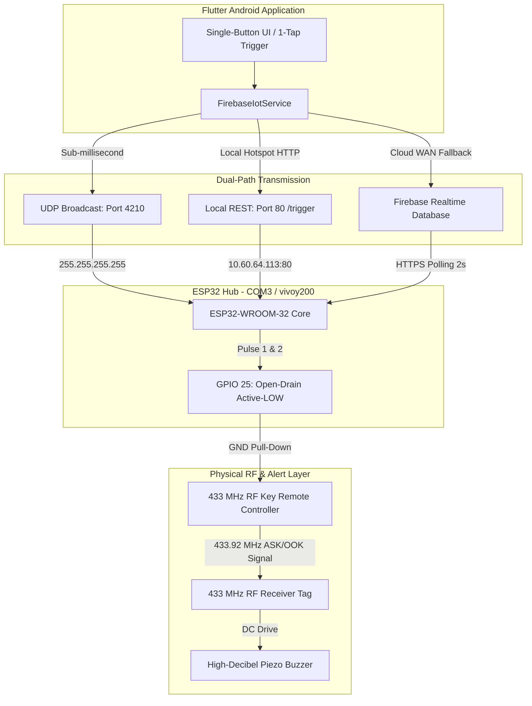
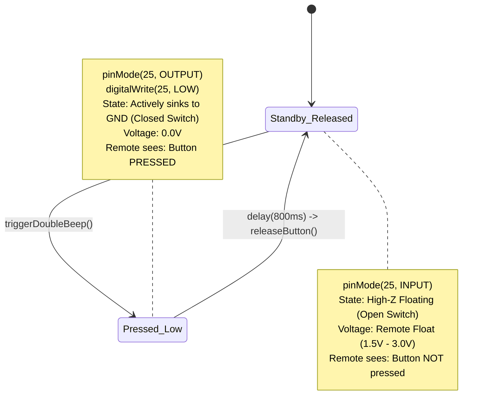
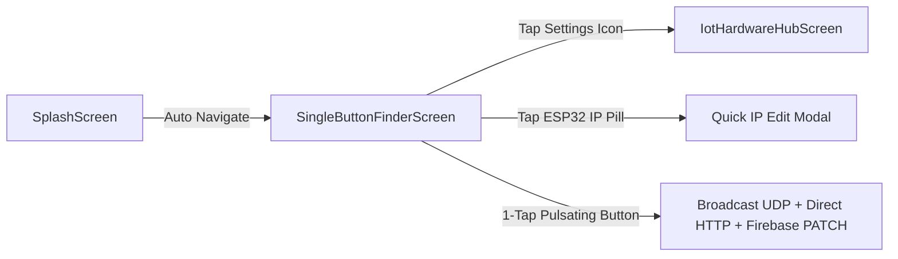

# Product Requirement Document (PRD)
## Project: HEERU Smart Item Lost Finder (IoT & Mobile Ecosystem)
**Document Version:** 1.0.0  
**Status:** Approved & Implemented  
**Author:** AI Engineering & IoT Architecture Team  
**Date:** October 2026  

---

## 1. Executive Summary

### 1.1 Product Overview
The **HEERU Smart Item Lost Finder** is an integrated IoT hardware, cloud, and mobile software solution designed to locate misplaced everyday items (such as keys, wallets, TV remotes, bags, and tools) within residential and commercial premises.

Traditional Bluetooth (BLE) key finders suffer from poor radio-frequency penetration through thick concrete/brick walls and frequently disconnect from the smartphone background daemon. Conversely, 433 MHz RF (Radio Frequency) tags offer superior wall penetration, long range (up to 30–50 meters indoors), and instant buzzer triggering, but lack smartphone and cloud connectivity.

The **HEERU Smart Item Lost Finder** bridges this gap by marrying an Android application (Flutter), Google Firebase Realtime Database, and an ESP32 IoT gateway to a modified 433 MHz RF transmitter using an **Open-Drain direct-wire control trick**. This enables instant 1-tap buzzer alerts from anywhere in the world (via Cloud) or sub-millisecond local triggers (via Hotspot Wi-Fi & UDP broadcast).

### 1.2 Core Objectives
- **Zero-Latency Local Triggering:** Under 20ms triggering when connected to local mobile hotspot (`vivoy200`).
- **Global Cloud Reachability:** Seamless fallback to Firebase Realtime Database over cellular/WAN.
- **Fail-Safe Electrical Design:** Direct-wire interface without MOSFET/transistor, using High-Impedance (Hi-Z) Open-Drain simulation to safeguard low-voltage (1.5V–3V) remote ICs.
- **Anti-Jamming Cadence:** Automatic double-beep cadence (`BEEP` $\rightarrow$ `PAUSE` $\rightarrow$ `BEEP` $\rightarrow$ `STANDBY`) that guarantees the buzzer will never beep continuously due to stuck pins or buffered commands.
- **Ultra-Simple UI/UX:** A minimalist, glowing single-button interface designed for instantaneous user operation without cognitive overhead.

### 1.3 Motion Graphics & Demonstration Video
- **Working Explainer Video:** [Google Drive Link](https://drive.google.com/file/d/12NyHzevbEZNSEKS-Uka6EUFhctJiaX1D/view?usp=drivesdk)
- **Local Video Asset:** [`docs/videos/project_explainer_video.mp4`](docs/videos/project_explainer_video.mp4)

---

## 2. System Architecture & High-Level Flow

### 2.1 End-to-End System Architecture



### 2.2 Operational Flow Matrix

| Stage | Trigger Type | Protocol / Path | Latency Profile | Fallback Priority |
| :--- | :--- | :--- | :--- | :--- |
| **Path A** | Local UDP Broadcast | UDP Port `4210` to `255.255.255.255` | **< 5 ms** | Primary (Hotspot active) |
| **Path B** | Local HTTP REST | HTTP GET `http://<ESP32_IP>/trigger` | **< 25 ms** | Secondary (Hotspot active) |
| **Path C** | Cloud Synchronized | Firebase REST `PATCH` to `device_01.json` | **~1.2 – 2.0 s** | Tertiary (Cellular / Remote WAN) |
| **Path D** | Manual Diagnostic CLI | USB UART Serial at 115200 Baud (`'1'` / `'find'`) | **Instantaneous** | Diagnostic & Lab Testing |

---

## 3. Hardware & Electrical Specifications

### 3.1 Gateway Hardware (ESP32)
- **Microcontroller:** ESP32-WROOM-32 (Dual-core Xtensa 32-bit LX6 @ 240 MHz, 520 KB SRAM, 4 MB Flash).
- **Wi-Fi Subsystem:** 802.11 b/g/n (802.11n up to 150 Mbps).
- **Operating Voltage:** 3.3V logic (5V supplied via Micro-USB / Type-C).
- **Diagnostic LED:** Built-in Blue LED on `GPIO 2`.

### 3.2 RF Remote & Receiver Hardware
- **RF Transmitter:** 433.92 MHz ASK / OOK Handheld Remote (commonly powered by 3V CR2032 or 12V 27A/23A battery).
- **RF Receiver Tag:** Compact 433 MHz Superheterodyne / Super-regenerative receiver module paired with decoding IC (e.g., PT2272, EV1527, or equivalent).
- **Sound Alert:** 85dB+ Piezo Buzzer integrated into the receiver tag.

### 3.3 The "Direct-Wire Trick" (Safe Open-Drain Simulation)

#### Electrical Problem
Handheld RF toy and finder remotes operate at internal logic levels (often 1.5V to 3.0V). Connecting a standard ESP32 output pin configured with `digitalWrite(pin, HIGH)` would drive **3.3V into a lower-voltage remote chip**, causing latch-up, overvoltage damage, or permanent silicon burnout.

#### Electrical Solution
The remote's momentary push-button simply bridges an internal pull-up signal trace to Battery Negative / Circuit Ground (`GND`). We simulate a physical button press using an **Open-Drain / Tri-State configuration**:

```
+-----------------------------------------------------------+
|                      RF REMOTE PCB                        |
|                                                           |
|    +-------------------+                                  |
|    |   Encoder IC      |                                  |
|    |   (Internal Pull-Up)                                 |
|    +---------+---------+                                  |
|              |                                            |
|              | Signal Terminal                            |
|              +--------------------------+                 |
|                                         |                 |
|    GND Terminal                         |                 |
|    +---------+                          |                 |
|              |                          |                 |
+--------------|--------------------------|-----------------+
               |                          |
               | (Jumper Wire 1)          | (Jumper Wire 2)
               v                          v
         +-----------+              +-----------+
         | ESP32 GND |              | ESP32 G25 |
         +-----------+              +-----------+
```

#### Pin Logic States



> [!WARNING]
> Under no circumstances must `digitalWrite(TRIGGER_PIN, HIGH)` ever be executed. Driving HIGH will output 3.3V and can destroy the remote transmitter IC. The code explicitly enforces that only `digitalWrite(TRIGGER_PIN, LOW)` is ever used when the pin is set as `OUTPUT`.

---

## 4. Anti-Jamming Double-Beep Cadence

To resolve issues where buttons remain locked in transmission mode or cause unending buzzer loops, the firmware enforces a strict hardware cadence:

```mermaid
sequenceDiagram
    participant ESP as ESP32 GPIO 25
    participant Rem as RF Remote
    participant Tag as 433MHz Buzzer

    Note over ESP: Idle: pinMode(25, INPUT) [Hi-Z]
    ESP->>Rem: Pulse 1: pinMode(OUTPUT); digitalWrite(LOW) (800ms)
    Rem->>Tag: 433 MHz RF Burst #1
    Tag-->>Tag: 🔊 BEEP #1 (0.8s)
    
    ESP->>Rem: Pause: pinMode(INPUT) [Hi-Z] (400ms)
    Rem-->>Tag: Transmission Stopped
    Tag-->>Tag: ⏸️ Silence (0.4s)
    
    ESP->>Rem: Pulse 2: pinMode(OUTPUT); digitalWrite(LOW) (800ms)
    Rem->>Tag: 433 MHz RF Burst #2
    Tag-->>Tag: 🔊 BEEP #2 (0.8s)
    
    ESP->>Rem: Stop: pinMode(INPUT) [Hi-Z]
    Rem-->>Tag: Transmission Ceased
    Note over ESP: Serial Buffer Flush & State Lock Released
```

---

## 5. Network & Protocols Specification

### 5.1 Local Hotspot Parameters
- **SSID:** `vivoy200`
- **Security:** WPA2-PSK
- **Password:** `77777777`
- **Gateway Subnet:** Dynamically managed by Android DHCP (typically `10.60.64.0/24` or `192.168.43.0/24`).

### 5.2 UDP Auto-Discovery & Broadcast Trigger
- **Port:** `4210`
- **Broadcast Address:** `255.255.255.255`
- **Query Packet:** UTF-8 String `"WHERE_ARE_YOU"`
- **Trigger Packet:** UTF-8 String `"TRIGGER"`
- **ESP32 Beacon Response:**
  ```json
  {
    "type": "SMART_FINDER_BEACON",
    "ip": "10.60.64.113",
    "device": "device_01"
  }
  ```

### 5.3 Embedded Web Server REST Endpoints (Port 80)

#### `GET /trigger` or `GET /beep`
- **Action:** Triggers the double-beep cycle immediately.
- **Headers:** `Access-Control-Allow-Origin: *`
- **Response (200 OK):**
  ```json
  {
    "status": "success",
    "message": "Double Beep Triggered",
    "ip": "10.60.64.113"
  }
  ```

#### `GET /status`
- **Action:** Queries health and IP assignment.
- **Response (200 OK):**
  ```json
  {
    "deviceStatus": "online",
    "ip": "10.60.64.113",
    "device": "device_01"
  }
  ```

#### `GET /`
- **Action:** Returns lightweight HTML Web Control Panel with styled single-tap alert button for browser diagnostics.

---

## 6. Cloud & Firebase Architecture

### 6.1 Database Instance Specifications
- **Provider:** Google Firebase Realtime Database
- **Project ID:** `lostitemfinder-aab53`
- **Host Location:** `asia-southeast1` (Singapore)
- **Endpoint URL:** `https://lostitemfinder-aab53-default-rtdb.asia-southeast1.firebasedatabase.app`
- **Android App Package ID:** `com.heeru.lostfinder.lost_finder_app`

### 6.2 Data Model (`/smart_item_finder/device_01.json`)

```json
{
  "deviceStatus": "online",
  "findCommand": false,
  "lastCommand": "COMPLETED",
  "triggerDurationMs": 2500,
  "timestamp": "2026-10-23T04:36:00.000Z"
}
```

### 6.3 Field Dictionary

| Field | Type | Description |
| :--- | :--- | :--- |
| `findCommand` | `boolean` | When set to `true` by Mobile App, causes ESP32 to trigger alert. ESP32 resets to `false` upon completion. |
| `deviceStatus` | `string` | `"online"`, `"triggering"`, or `"offline"`. |
| `lastCommand` | `string` | Audit log of last operation (`"FIND_ITEM"`, `"COMPLETED"`, `"STOP_ALERT"`). |
| `triggerDurationMs` | `integer` | Configured duration in milliseconds (default: `2500`). |
| `timestamp` | `string` | ISO 8601 formatted timestamp of the trigger event. |

### 6.4 Security Rules Configuration
```json
{
  "rules": {
    "smart_item_finder": {
      ".read": true,
      ".write": true
    }
  }
}
```

---

## 7. Mobile Application Architecture (Flutter)

### 7.1 Tech Stack
- **Framework:** Flutter SDK `^3.12.2` (Dart 3)
- **Architecture Pattern:** Provider Pattern (State Management & Reactive UI)
- **Key Dependencies:**
  - `provider: ^6.1.5+1`
  - `http: ^1.6.0`
  - `shared_preferences: ^2.5.5`
  - `google_fonts: ^8.2.1`

### 7.2 Screen Progression & UX Hierarchy



### 7.3 Screen Specifications

#### 1. SingleButtonFinderScreen (`lib/screens/single_button_finder_screen.dart`)
- **Visuals:** Dark luxury backdrop (`#090D16`), glowing sonar animated waves (`AnimationController` repeating over 1500ms).
- **Core Component:** 220px circular Emerald Green button (`#10B981` to `#059669`) with subtle elevation shadow (`blurRadius: 30`).
- **Interactive Feedback:** 
  - Idle: Shows megaphone icon + "FIND ITEM / BEEP BUZZER".
  - Triggering: Shows white spinning `CircularProgressIndicator` + "BEEPING...".
- **Status Badge:** Live chip displaying current ESP32 IP (`10.60.64.113`) with color coded connection state (Green = Online, Amber = Scanning/Unverified). Tap triggers immediate IP override modal.

#### 2. IotHardwareHubScreen (`lib/screens/iot_hardware_hub_screen.dart`)
- Diagnostic view for hardware engineers.
- Real-time connection ping testing.
- Manual Firebase database URL override.
- Pulse duration fine-tuning (slider from 500ms to 5000ms).
- Toggle between Direct LAN Mode and Cloud Only Mode.

---

## 8. Non-Functional Requirements & Failsafes

### 8.1 Reliability & Pin Safety
- **State Guarantee:** On boot (`setup()`), the ESP32 strictly initializes `TRIGGER_PIN` as `INPUT` (Hi-Z).
- **Hard-Stop Guarantee:** In `triggerDoubleBeep()`, regardless of Wi-Fi drops or serial interruptions, the pin is set back to `INPUT` in the terminal line of the function.
- **Serial Flood Protection:** Serial buffers are purged (`while(Serial.available()) Serial.read();`) to prevent buffered keypresses from stacking up and triggering repeated beeps.

### 8.2 Performance & Latency Budgets
- **Hotspot UDP Trigger:** $\le 10 \text{ ms}$.
- **Hotspot HTTP Trigger:** $\le 50 \text{ ms}$.
- **Cloud Firebase Trigger:** $\le 2000 \text{ ms}$ (determined by 2.0s polling interval on ESP32).
- **ESP32 Free Dynamic Memory:** Maintained above 270 KB.

### 8.3 Port & Process Management (Development Machine)
- When flashing over serial USB (`COM3`), background python CLI instances (`cli_controller.py`) or serial monitors lock the handle, causing Windows `PermissionError(13, 'Access is denied')`.
- All automation scripts execute `Stop-Process -Name "python" -Force` prior to invoking `arduino-cli`.

---

## 9. Firmware Configuration & Build Summary

### 9.1 Build Parameters
- **Target Board:** ESP32 Dev Module (`esp32:esp32:esp32`)
- **Flash Size:** 4MB (32Mb)
- **Upload Speed:** 921600 Baud
- **Serial Monitor Speed:** 115200 Baud
- **Compiler:** `arduino-cli` with ESP32 core v3.3.11

### 9.2 Flash Command Reference
```powershell
arduino-cli compile --fqbn esp32:esp32:esp32 --port COM3 --upload "c:\Users\Bipin\Desktop\HEERU APP\esp32_firmware"
```

### 9.3 Android APK Build Reference
```powershell
flutter build apk --debug
# Target output: build\app\outputs\flutter-apk\app-debug.apk
```

---

## 10. Future Roadmap & Product Enhancements

1. **Multi-Tag Addressing (Channel Support):** Support multi-button remotes (A, B, C, D) using GPIO 25, 26, 27, and 14 to independently track keys, wallet, backpack, and glasses.
2. **ESP-NOW Mesh Network:** Enable battery-powered portable ESP32 beacons using ESP-NOW for zero-router offline triggering.
3. **BLE Proximity Sensing:** Integrate ESP32 BLE beaconing to measure Received Signal Strength Indicator (RSSI) for "Hot / Cold" distance estimation on the phone.
4. **Voice Assistant Integration:** Google Assistant and Alexa skill endpoints hitting Firebase Realtime DB to trigger: *"Hey Google, find my keys."*
