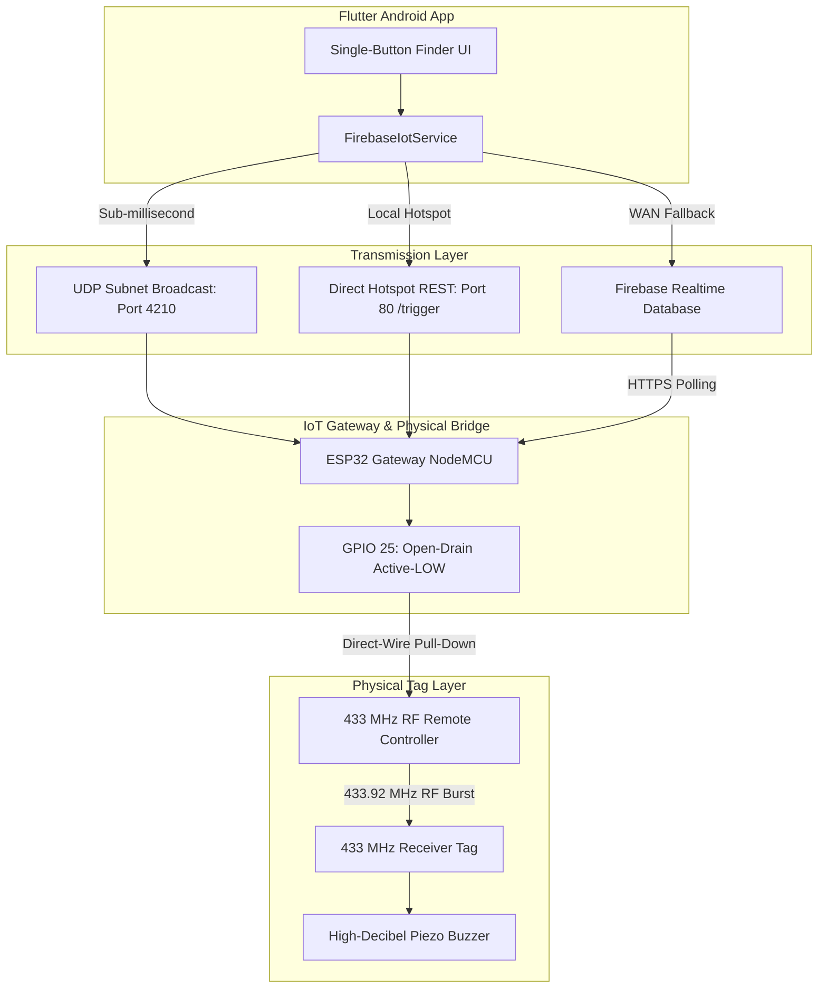
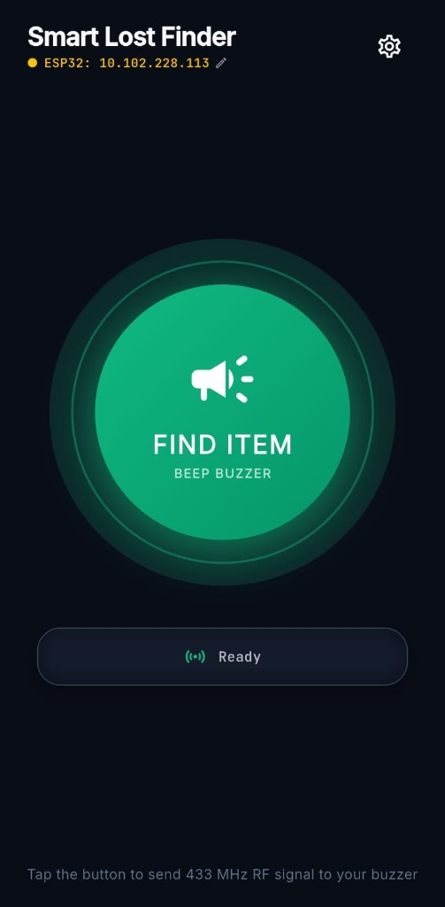
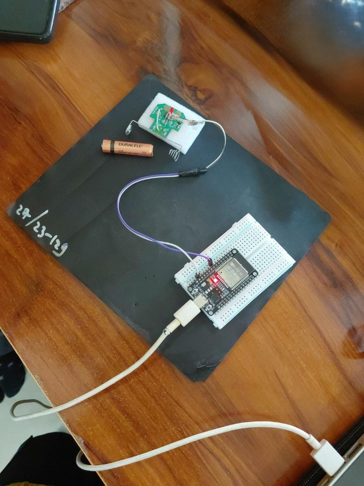
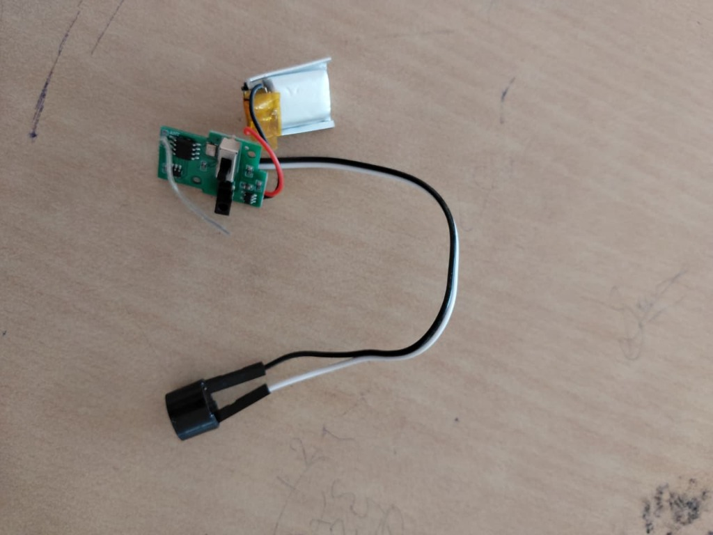

# 🛰️ Smart Item Lost Finder Using IoT

An end-to-end IoT, Cloud, and Mobile ecosystem designed to locate lost or misplaced everyday items (keys, remotes, bags, tools) using a hybrid combination of **Flutter Android App**, **Google Firebase Realtime Database**, **ESP32 Gateway**, and **433 MHz RF direct-wire signaling**.

---

## 📌 Architecture Overview



---

## ✨ Key Features

1. **Dual-Path Redundant Triggering:**
   - **Local Subnet UDP Broadcast (Port 4210):** Sub-millisecond trigger across Android hotspot without needing DNS resolution.
   - **Direct Local HTTP REST (`/trigger`):** Instant sub-25ms response over local Wi-Fi.
   - **Firebase Realtime Database Sync (`asia-southeast1`):** Worldwide cloud trigger fallback over cellular data/WAN.
2. **Safe Open-Drain Direct-Wire Interface:**
   - Controls standard 1.5V–3V toy and RF remotes with just 2 jumper wires without transistors or MOSFETs.
   - **Press:** `pinMode(25, OUTPUT); digitalWrite(25, LOW);` (sinks button to GND).
   - **Release:** `pinMode(25, INPUT);` (returns pin to High-Z floating state, never driving 3.3V into the low-voltage remote IC).
3. **Anti-Jamming Double-Beep Cadence:**
   - Sequence: `0.8s BEEP` $\rightarrow$ `0.4s PAUSE` $\rightarrow$ `0.8s BEEP` $\rightarrow$ `SAFE RELEASE`.
   - Prevents continuous beeping from stuck buttons or buffered serial inputs.
4. **Modern Minimalist Flutter UI:**
   - Single-button pulsating sonar animation with emerald glow.
   - Live IP status chip with tap-to-edit modal for dynamic hotspot subnets.
   - Dedicated IoT Diagnostics & Hardware Hub screen.

---

## 🎬 Project Explainer & Motion Graphics Video

Watch the motion graphics presentation and working demonstration of the **Smart Item Lost Finder**:

- 🔗 **Google Drive Stream:** [Watch on Google Drive](https://drive.google.com/file/d/12NyHzevbEZNSEKS-Uka6EUFhctJiaX1D/view?usp=drivesdk)
- 📁 **Repository Video File:** [`docs/videos/project_explainer_video.mp4`](docs/videos/project_explainer_video.mp4)

---

## 📸 Implementation & Hardware Prototype

| 1. Mobile App Interface | 2. ESP32 Gateway & Direct-Wire Bridge | 3. 433 MHz Receiver Tag & Buzzer |
| :---: | :---: | :---: |
|  |  |  |
| **1-Tap Finder Screen**<br>Dynamic IP Chip & Pulsating Glow | **ESP32 Gateway Bridge**<br>Direct-Wire Interface on GPIO 25 | **Compact Tag Prototype**<br>LiPo Battery, RF IC & Piezo Buzzer |

---

## 🔌 Hardware Circuit & Wiring

| ESP32 Pin | RF Remote Connection | Function |
| :--- | :--- | :--- |
| **GND** | Remote Battery Negative `(-)` / GND | Common Ground Reference |
| **GPIO 25** | Remote Button Signal Pin (Opposite GND) | Open-Drain Simulated Button Press |
| **5V / Micro-USB**| USB Power Supply / Power Bank | Gateway Power |
| **GPIO 2** | On-board Blue LED | Visual Status Indicator |

---

## 📂 Project Directory Structure

```text
├── android/               # Android native configuration & AndroidManifest
├── esp32_firmware/        # Arduino/C++ firmware for ESP32
│   └── esp32_firmware.ino # Main gateway sketch (UDP, HTTP, Firebase, GPIO)
├── lib/
│   ├── main.dart          # App entry point
│   ├── screens/           # UI Screens (SingleButtonFinderScreen, Hub, etc.)
│   ├── services/          # FirebaseIotService (UDP, HTTP, RTDB engine)
│   ├── theme/             # Modern Dark/Light typography and palettes
│   └── widgets/           # GlassContainer & custom UI components
├── cli_controller.py      # Python Serial CLI diagnostic utility
├── HARDWARE_AND_CIRCUIT_SETUP.md # Detailed circuit & pinout instructions
├── PRD.md                 # Complete Product Requirement Document
└── pubspec.yaml           # Flutter package dependencies
```

---

## 🚀 Getting Started

### 1. Flash the ESP32 Gateway
Using `arduino-cli`:
```powershell
arduino-cli compile --fqbn esp32:esp32:esp32 --port COM3 --upload esp32_firmware
```

### 2. Configure Hotspot & Firebase
- **Hotspot SSID:** `vivoy200`
- **Password:** `77777777`
- **Firebase Endpoint:** `https://lostitemfinder-aab53-default-rtdb.asia-southeast1.firebasedatabase.app`
- In your Firebase Console, ensure the Realtime Database rules allow read/write:
  ```json
  {
    "rules": {
      ".read": true,
      ".write": true
    }
  }
  ```

### 3. Build & Run the Mobile App
```bash
flutter pub get
flutter build apk --debug
# Install directly via ADB:
adb install -r build/app/outputs/flutter-apk/app-debug.apk
```

---

## 📜 License
This project is open-source under the MIT License.
